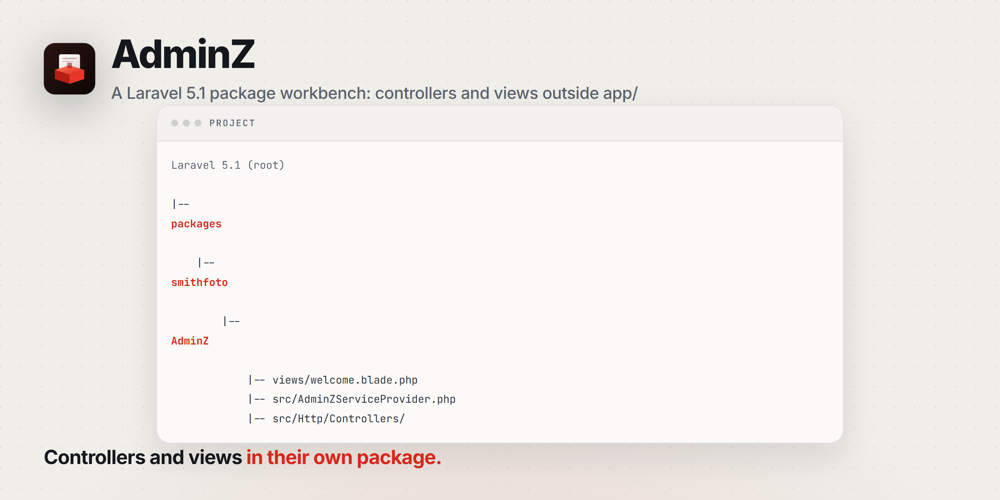

<div align="center">


# AdminZ

**A Laravel 5.1 package workbench: keep your controllers and views in their own package, outside the app folder.**


</div>

<picture>
  <source media="(prefers-color-scheme: dark)" srcset="art/banner-dark.png">
  
</picture>

Laravel 5.1 Controller & View Package outside `app` folder.

Directory & Files Structure
---------------------------
``` ruby
Laravel 5.1 (root dir)
|-- packages
    |-- smithfoto
        |-- AdminZ
            |-- views
                |-- welcome.blade.php
            |-- src
                |-- AdminZServiceProvider.php
                |-- Http
                    |-- routes.php
                        |-- Controllers
                            |-- WelcomController.php
```
Add service provider in `config/app`

``` ruby
SmithFoto\AdminZ\AdminZServiceProvider::class,

```

Add package path in root `composer.json`

``` ruby
"psr-4":{
            "App\\": "app/",
            "SmithFoto\\AdminZ\\": "packages/smithfoto/AdminZ/src"
        }
```

run `composer dump-autoload`

test packages with url `http://your-domain.com/admin`
